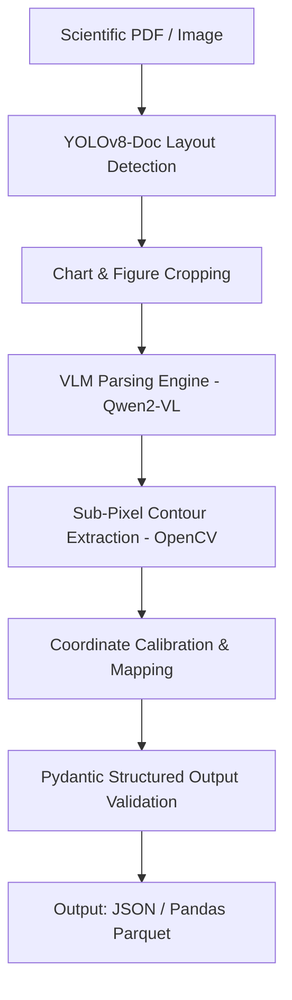

# Multimodal Chart & Spectra Vision LLM: Automated Scientific Data Extraction

[](https://opensource.org/licenses/MIT)
[]()
[]()

An end-to-end multimodal vision-language pipeline specializing in the parsing, coordinate de-skewing, and digitized tabular extraction of complex scientific figures (UV-Vis spectra, ternary phase diagrams, XRD patterns, and kinetic Arrhenius plots).

---

## 🔬 Core Capabilities

* **Scientific Figure Parsing:** Dissects non-standard scientific axes (log-linear, inverted wave-numbers, dual Y-axes).
* **Spectral Curve Digitization:** Extracts continuous raw $(x, y)$ coordinate points from rasterized plot images using combined Vision-Language Models (VLMs) and OpenCV edge-tracking.
* **Ternary & Phase Diagram Decomposition:** Reconstructs component molar fractions $(x_A, x_B, x_C)$ directly from triangular phase diagrams.
* **Strict Pydantic Validation:** Guarantees machine-readable, schema-verified JSON outputs suitable for automated Materials Informatics databases.

---

## 🏗️ Architecture



---

## 🚀 Quickstart

```bash
git clone https://github.com/dhrubchatterjee16-lang/multimodal-chart-vision-llm.git
cd multimodal-chart-vision-llm
pip install -r requirements.txt
python extract_chart.py --image_path examples/uv_vis_spectrum.png --output_format json
```
